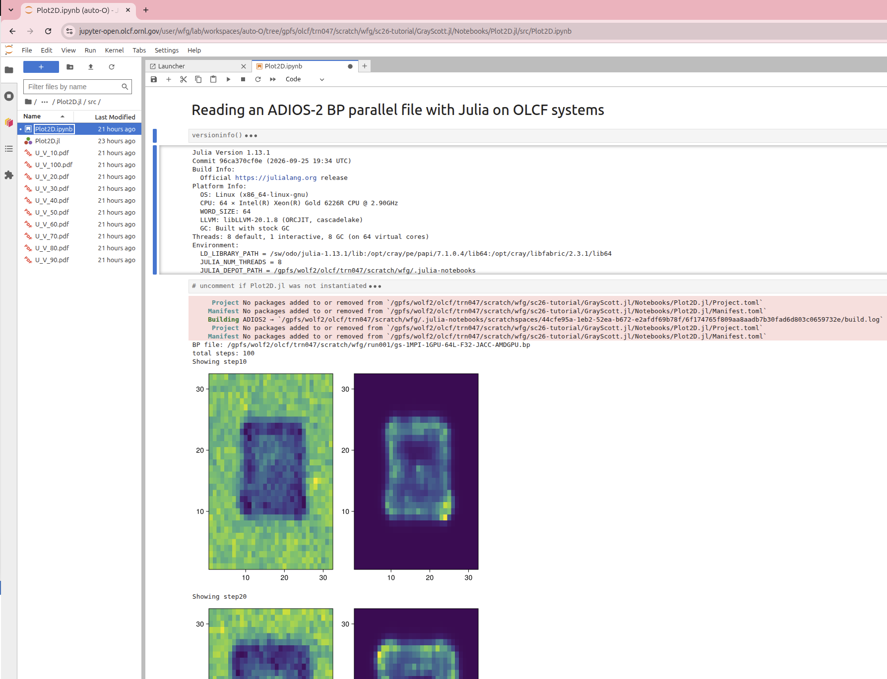

# Running, Profiling, and Data Analysis on Odo/Frontier

This instructions are for the [Odo training system at OLCF](https://docs.olcf.ornl.gov/systems/odo_user_guide.html). Which is almost identical to [Frontier](https://docs.olcf.ornl.gov/systems/frontier_user_guide.html).

## Setting up the code

We assume the user has access to the `trn047` training account.

1. *Access Odo/Frontier*

    ```
    $ ssh USERNAME@odo.olcf.ornl.gov
    ```

2. *Obtain the Gray-Scott.jl code*: first access your scratch directory, clone the repository.

    ```
    cd /gpfs/wolf2/olcf/trn047/scratch/$USER
    git clone https://github.com/JuliaORNL/GrayScott.jl.git
    ```

3. *Configure the environment*: Run the script prepared for this tutorial [`GrayScott.jl/scripts/config_odo.sh`](https://github.com/JuliaORNL/GrayScott.jl/blob/main/scripts/config_odo.sh) to set up modules, environment, and package dependencies. This is a one-time step and might take a few minutes.

    ```bash
    source GrayScott.jl/scripts/config_odo.sh
    ```

    ```bash
    #!/bin/bash

    PROJ_DIR=/gpfs/wolf2/olcf/trn047/scratch/$USER
    export JULIA_DEPOT_PATH=$PROJ_DIR/.julia
    GS_DIR=$PROJ_DIR/GrayScott.jl

    # remove existing generated Manifest.toml
    rm -f $GS_DIR/Manifest.toml
    rm -f $GS_DIR/LocalPreferences.toml

    # good practice to avoid conflicts with existing default modules
    module purge

    ROCM_VERSION=7.2.0

    # load required modules
    module load PrgEnv-cray/8.6.0
    module load cray-mpich
    module load rocm/$ROCM_VERSION
    module load adios2/2.10.0-mpi
    module load julia/1.13.1

    # AMDGPU.jl requires rocm system libraries (default = /opt/rocm)
    export ROCM_PATH=/opt/rocm-$ROCM_VERSION

    # Required to point at underlying modules above
    export JULIA_ADIOS2_PATH=$OLCF_ADIOS2_ROOT

    # Downloads Julia packages in Project.toml
    julia --project=$GS_DIR -e 'using Pkg; Pkg.instantiate()'

    # Set MPIPreferences to use Cray's MPICH in LocalPreferences.toml
    julia --project=$GS_DIR -e 'using MPIPreferences; MPIPreferences.use_system_binary(mpiexec="srun", vendor="cray")'

    # Set JACC AMDGPU back end in LocalPreferences.toml.
    # It will add AMDGPU to Project.toml
    julia --project=$GS_DIR -e 'using JACC; JACC.set_backend("AMDGPU")'

    # Verify the packages are installed correctly
    julia --project=$GS_DIR -e 'using Pkg; Pkg.build()'
    # Precompile dependencies
    julia --project=$GS_DIR -e 'using Pkg; Pkg.precompile()'
    ```

  {: .info }
  The JULIA_DEPOT (set by the environment variable `JULIA_DEPOT_PATH`) is where Julia packages and artifacts (e.g., extra data) will be installed for different local environments. Do not use $HOME for limited performance - not scalable - and storage reasons.

  {: .info }


## Running jobs

1. Create an area for Gray-Scott runs outside the repository (e.g. run001, future runs will be in run002, run003, etc.)

    ```bash
    mkdir run001
    ```

2. Copy the Gray-Scott settings file and the job_odo.sh to the run directory

    ```bash
    cp GrayScott.jl/examples/settings-file-odo.json run001
    cp GrayScott.jl/scripts/job_odo.sh run001
    ```

3. Submit your first job to Odo. It should generate an adios bp file output, and total runtime should be around 17 seconds using a single MPI process and AMD GPU.

    ```bash
    cd run001
    sbatch job_odo.sh
    ```

4. Check the output files generated by the job with ADIOS2 bpls

    ```bash
    bpls -lav gs-1MPI-1GPU-64L-F32-JACC-AMDGPU.bp
    ```

    ```xml
    File info:
    of variables:  3
    of attributes: 13
    statistics:    Min / Max 

    double   Du                           attr   = 0.2
    double   Dv                           attr   = 0.1
    double   F                            attr   = 0.02
    string   Fides_Data_Model             attr   = "uniform"
    string   Fides_Dimension_Variable     attr   = "U"
    double   Fides_Origin                 attr   = {0, 0, 0}
    double   Fides_Spacing                attr   = {0.1, 0.1, 0.1}
    string   Fides_Variable_Associations  attr   = {"points", "points"}
    string   Fides_Variable_List          attr   = {"U", "V"}
    float    U                            100*{64, 64, 64} = -0.115931 / 1.46275
    float    V                            100*{64, 64, 64} = 0 / 1.04308
    double   dt                           attr   = 1
    double   k                            attr   = 0.048
    double   noise                        attr   = 0.1
    int32_t  step                         100*scalar = 10 / 1000
    string   vtk.xml                      attr   = 
    <VTKFile type="ImageData" version="0.1" byte_order="LittleEndian">
      <ImageData WholeExtent="0 64 0 64 0 64" Origin="0 0 0" Spacing="1 1 1">
        <Piece Extent="0 64 0 64 0 64">
          <CellData Scalars="U">
            <DataArray Name="U" />
            <DataArray Name="V" />
            <DataArray Name="TIME">
                  step
                </DataArray>
          </CellData>
        </Piece>
      </ImageData>
    </VTKFile>
    ```

5. Future runs: repeats steps 1-3 above , and edit the settings file to set the desired parameters for the Gray-Scott simulation.

   - `L` is the number of cells on each direction, Lx = Ly = Lz = L, so L^3 is the total number of cells.
   - `plotgap` is the number of steps between each visualization output.
   - `steps` is the total number of steps to run the simulation.
   - `output` is the name of the adios2 output directory dataset (can be visualized with ParaView for small cases)[docs](https://adios2.readthedocs.io/en/latest/ecosystem/visualization.html).
   - Other variables might not influence the simulation but can be changed for testing purposes.

    ```json
    {
    "L": 64,
    "Du": 0.2,
    "Dv": 0.1,
    "F": 0.02,
    "k": 0.048,
    "dt": 1.0,
    "plotgap": 10,
    "steps": 1000,
    "noise": 0.1,
    "output": "gs-1MPI-1GPU-64L-F32-JACC-AMDGPU.bp",
    "checkpoint": false,
    "checkpoint_freq": 700,
    "checkpoint_output": "ckpt.bp",
    "restart": false,
    "restart_input": "ckpt.bp",
    "adios_config": "adios2.xml",
    "adios_span": false,
    "adios_memory_selection": false,
    "mesh_type": "image",
    "precision": "Float32"
    }
    ```

6. Edit the launch script to request more resources: nodes, gpus, time (follow instructors directions at this point)

    ```bash
    #!/bin/bash
    #SBATCH -A trn047
    #SBATCH -J gs-julia-1MPI-1GPU
    #SBATCH -o %x-%j.out
    #SBATCH -e %x-%j.err
    #SBATCH -t 0:02:00
    #SBATCH -N 1

    date
    #rocminfo

    GS_DIR=/gpfs/wolf2/olcf/trn047/scratch/$USER/GrayScott.jl
    GS_EXE=$GS_DIR/gray-scott.jl

    srun -n 1 --gpus=1 julia --project=$GS_DIR $GS_EXE settings-file-odo.json

    # launch this file with sbatch `$ sbatch job_odo.sh`
    ```

## Profiling with rocprof
Adding profiling with `rocprof` allows you to analyze the performance of your Gray-Scott simulation on the GPU. This can help identify bottlenecks and optimize the code for better performance. Since Julia and the GPU backends 

1. Adding rocprof to the launch script:

    ```bash
    #!/bin/bash
    #SBATCH -A trn047
    #SBATCH -J gs-julia-1MPI-1GPU
    #SBATCH -o %x-%j.out
    #SBATCH -e %x-%j.err
    #SBATCH -t 0:02:00
    #SBATCH -N 1

    date
    #rocminfo

    GS_DIR=/gpfs/wolf2/olcf/trn047/scratch/$USER/GrayScott.jl
    GS_EXE=$GS_DIR/gray-scott.jl

    srun -n 1 --gpus=1 rocprof -i input.txt -o profiling.csv julia --project=$GS_DIR $GS_EXE settings-file-odo.json

    # launch this file with sbatch `$ sbatch job_odo_rocprof.sh`
    ```

    where input.txt is the file containing the profiling input counters and profiling.csv is the output file containing the profiling results.

    input.txt:

    ```
    $ cat input.txt 
    # Perf counters group 1
    pmc : Wavefronts VALUInsts SALUInsts SFetchInsts
    # Perf counters group 2
    pmc : TCC_HIT[0], TCC_MISS[0]
    ```

    profiling.csv:

    ```
    Index,KernelName,gpu-id,queue-id,queue-index,pid,tid,grd,wgr,lds,scr,arch_vgpr,accum_vgpr,sgpr,wave_size,sig,obj,Wavefronts,VALUInsts,SALUInsts,SFetchInsts,TCC_HIT[0],TCC_MISS[0]
    0,"gpu_fill_kernel_(CompilerMetadata<DynamicSize, DynamicCheck, void, CartesianIndices<1, Tuple<OneTo<Int64> > >, NDRange<1, DynamicSize, DynamicSize, CartesianIndices<1, Tuple<OneTo<Int64> > >, CartesianIndices<1, Tuple<OneTo<Int64> > > > >, ROCDeviceArray<Float64, 3, 1>, Float64) [clone .kd]",4,0,0,3025283,3025283,17174528,1024,0,0,8,0,16,64,0x0,0x7ffe57ac0880,268352.0000000000,22.9991056523,10.9995528261,4.9998323098,33542,33542
    1,"gpu_fill_kernel_(CompilerMetadata<DynamicSize, DynamicCheck, void, CartesianIndices<1, Tuple<OneTo<Int64> > >, NDRange<1, DynamicSize, DynamicSize, CartesianIndices<1, Tuple<OneTo<Int64> > >, CartesianIndices<1, Tuple<OneTo<Int64> > > > >, ROCDeviceArray<Float64, 3, 1>, Float64) [clone .kd]",4,0,2,3025283,3025283,17174528,1024,0,0,8,0,16,64,0x0,0x7ffe57ac0880,268352.0000000000,22.9991056523,10.9995528261,4.9998323098,33542,33542
    ```

    The above contains per-kernel profiling results for the specified performance counters. More information available in the [AMD rocprof documentation](https://rocm.docs.amd.com/projects/rocprofiler/en/latest/how-to/using-rocprof.html).


## Visualizing the output on jupyter-open.olcf.ornl.gov

1. Setup a IJulia kernel for OLCF JupyterHub open and instantiate the project dependencies:

    ```
    cd /gpfs/wolf2/olcf/trn047/scratch/$USER/GrayScott.jl/Notebooks/Plot2D.jl
    source config_Odo_IJulia_kernel.sh
    ```

    ```
    #!/bin/bash

    module load julia/1.13.1

    export JULIA_DEPOT_PATH=/gpfs/wolf2/olcf/trn047/scratch/$USER/.julia-notebooks

    # instantiate project packages: ADIOS2, CairoMakie, IJulia
    julia --project -e 'using Pkg; Pkg.instantiate()'

    # configure IJulia kernel for Odo project
    JUPYTER_KERNEL_FILE=$HOME/.local/share/jupyter/kernels/julia-hpc-sc26-1.13/kernel.json

    if [ ! -f "$JUPYTER_KERNEL_FILE" ]; then
        echo "Installing IJulia kernel for julia-hpc-sc26"
        julia --project -e 'using IJulia; installkernel("julia-hpc-sc26", "--project=@.", env=Dict( "USER" => ENV["USER"], "PATH" => ENV["PATH"], "LD_LIBRARY_PATH" => ENV["LD_LIBRARY_PATH"], "JULIA_DEPOT_PATH" => ENV["JULIA_DEPOT_PATH"], "JULIA_NUM_THREADS" => "8"))'
    fi

    # resulting kernel.json
    cat $JUPYTER_KERNEL_FILE
    echo "Now log into https://jupyter-open.olcf.ornl.gov/ and select the julia-hpc-sc26 1.13 kernel to run Plot2D.ipynb"
    ```

    The script will output the contents of the resulting `$HOME/.local/share/jupyter/kernels/julia-hpc-sc26-1.13/kernel.json` file to verify the kernel installation.

    The file contents should look similar to the following:

    ```json
    {
    "interrupt_mode":"signal",
    "language":"julia",
    "argv":["/autofs/nccsopen-svm1_sw/odo/julia-1.13.1/bin/julia","-i","--color=yes","--project=@.","-e","import IJulia; IJulia.run_kernel()","{connection_file}"],
    "env":{"JULIA_NUM_THREADS":"8","JULIA_DEPOT_PATH":"/gpfs/wolf2/olcf/trn047/scratch/wfg/.julia-notebooks","PATH":"/sw/odo/julia-1.13.1/bin:/opt/conda/bin: ...,"LD_LIBRARY_PATH":"/sw/odo/julia-1.13.1/lib: ..."},
    "display_name":"julia-hpc-sc26 1.13"
    } 
    ```

2. Go to the OLCF JupyterHub Open portal: [https://jupyter-open.olcf.ornl.gov/](https://jupyter-open.olcf.ornl.gov/). After signing in and selecting the Onyx Compute resource, select the `julia-hpc-sc26 1.13` kernel to run the `Plot2D.ipynb` notebook to inspect data from `run001`. 

3. Browse into the notebook location if it is not immediately visible: `/gpfs/wolf2/olcf/trn047/scratch/$USER/GrayScott.jl/Notebooks/Plot2D.jl/src`

4. Run the Notebook cells (right triangle or Run menu > Run All Cells) and check you can get to the picture shown below. It might take some time for the packages to be precompiled. The result is a generated set of pdf files containing the 2D `x-y` visualizations of the simulation data on the `z=L/2` plane
This is your first complete workflow from running a Gray-Scott simulation on Perlmutter high-performance computing system and visualizing the results on JupyterHub Open. 

    
    *Gray-Scott U and V output visualization using Makie.jl and ADIOS2.jl*

5. Congratulations! You have run high-performance computing code and do the data analysis using one language.
